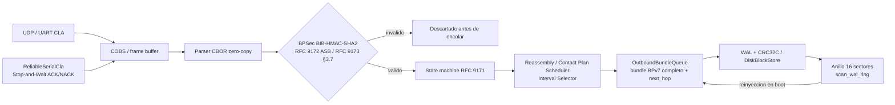
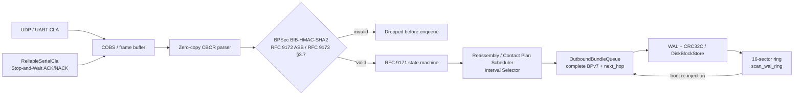

# dtn-core — Motor DTN (BPv7) `no_std` y cero asignaciones

[](#verificacion)
[](#verificacion)
[](https://docs.rust-embedded.org/book/intro/no-std.html)
[](#licencia)

Requiere Rust estable 1.80 o posterior (fijado en `rust-toolchain.toml`).
Miri se ejecuta con `nightly` porque no es componente del toolchain estable.

## Índice / Index

- [Español](#español)
- [English](#english)

---

## Español

`dtn-core` implementa los componentes centrales de un motor DTN (Bundle
Protocol v7, RFC 9171) para sistemas embebidos *bare-metal* y `no_std`.
Garantías de diseño:

- **Cero asignaciones en el hot-path.** El crate es estrictamente `#![no_std]`;
  no enlaza `alloc`. Cada buffer es un slice prestado o un arreglo de tamaño
  constante definido por el llamador.
- **Zero-copy con lifetimes explícitos.** Los parsers devuelven referencias al
  slice original; no se copian cabeceras ni payloads BP.
- **Errores explícitos.** Toda operación falible devuelve
  `DtnResult<T> = Result<T, DtnError>`, un discriminante `Copy` sin `panic`
  ante entrada hostil.
- **Corrección con memoria débil.** El ring buffer SPSC usa acquire/release;
  las métricas usan relaxed / fetch-min / fetch-max según corresponda.
- **Persistencia atómica.** Cada registro del WAL se sella en una página con
  CRC32C y número de secuencia monótono; `recover()` descarta escrituras
  parciales y corrupción de bits. `scan_wal_ring()` reconstruye un anillo de
  16 sectores reutilizando una sola página de 4 KiB. Los registros de reenvío
  llevan un `WalEnvelope` de 16 B (`Pending` / `Delivered`, `bundle_id_crc` y
  `next_hop`); el replay omite los `Pending` ya entregados. El CRC32C protege el
  WAL; **no es un contexto BPSec**.
- **Integridad BPSec.** El pipeline verifica el BIB antes de encolar: bloque
  canónico tipo 11 con ASB de RFC 9172 y único contexto RFC 9173
  `BIB-HMAC-SHA2 = 1`, SHA variant `5` (HMAC 256/256). La IPPT se construye
  según RFC 9173 §3.7 con **`Scope Flags = 1`** (`BIB_SCOPE_PRIMARY_BLOCK =
  0x01`, Primary + Payload); la cabecera del bloque objetivo no se incluye en el
  scope actual. No hay contexto CRC32C inventado; cualquier alteración del
  payload o del tag produce `DropIntegrityFailed` sin `alloc`.
- **Reenvío del bundle completo y transaccional.**
  `OutboundBundleQueue<SLOTS, MAX_BUNDLE_SIZE>` guarda
  `[next_hop: u64 LE | len: u16 LE | bytes BPv7 completos]`. Una entrada recién
  encolada queda `pending` y no es visible hasta `mark_last_persisted()`, que el
  firmware llama solo tras verificar Flash; un fallo usa
  `discard_last_pending()`. Los bundles recuperados del WAL se reinyectan con su
  `next_hop` original.
- **Enlace confiable.** `ReliableSerialCla` añade Stop-and-Wait ARQ sobre COBS
  con tiempo inyectado (`u64`). `send()` devuelve `QueueFull` si ya hay una
  trama en vuelo (`AwaitingAck`) o el enlace falló (`Failed`). La recepción
  **no confirma automáticamente**: crea `PendingCommit` y el firmware solo
  envía el ACK con `commit_rx_ack()` tras verificar Flash; ante fallo BPSec o
  Flash usa `reject_rx_nack()`. Tras agotar `max_retries` el bundle se retiene
  en el WAL.

### Módulos

| Módulo | Contenido |
|--------|-----------|
| `error` | `DtnError` / `DtnResult`: errores `Copy`, sin `std::error::Error`. |
| `parser::cbor` | Primitivas CBOR acotadas: longitudes, saltos con límite de profundidad. |
| `parser::primary_block` | Bloque primario RFC 9171 (arreglo de 8–11 elementos) y formato mapa heredado; `ParsedBundleHeader::rfc_array` distingue ambos. |
| `parser::extension_blocks` | Bloques canónicos (Payload=1, Previous Node=6, Bundle Age=7, Hop Count=10) y validación de edad/saltos. |
| `processor::state_machine` | Política RFC 9171: expiración, longitud de lifetime, Bundle Age, Hop Count, flags de borrado, payload único y último. |
| `processor::fragmentation` | **Experimental**: `ReassemblySlot<const BUF_SIZE, const MAX_FRAGMENTS>` gestiona rangos y solapamientos parciales (orden arbitrario), pero no reconstruye el ADU multi-fragmento end-to-end. |
| `processor::pipeline` | `IngestionPipeline`: validación → reensamblado → selector de intervalos del plan de contactos → cola estática de bundles completos → WAL. |
| `routing::interval_tree` | **Contact Plan Scheduler / Interval Selector**: `CgrIntervalTree<const CAP>` con búsqueda EAT de un salto; solapamientos prefieren la ventana activa más larga. El CGR multi-salto completo es trabajo futuro. |
| `storage::ring_buffer` | `LockFreeRingBuffer<const SIZE>` SPSC alineado a 64 bytes. |
| `storage::outbound` | `OutboundBundleQueue<SLOTS, MAX_BUNDLE_SIZE>`: cola estática con frame `[next_hop u64 LE | len u16 LE | bundle BPv7 completo]`; entradas `pending` invisibles hasta `mark_last_persisted()`. |
| `storage::crc32c` | CRC32C (Castagnoli) sin tabla, por chunks (integridad del WAL, no BPSec). |
| `storage::wal` | `DirectWal<const PAGES>`: 1 registro por página de 4096 B, `WalEnvelope` de 16 B, `append_record()`, `recover_pages()` y `scan_wal_ring()` (anillo de 16 sectores con un solo buffer de 4 KiB). |
| `storage::disk_sink` | `DiskBlockStore<const MAX_PAGES>` y `recover()` sobre el WAL en disco. |
| `bpsec` | BIB tipo 11 con ASB RFC 9172 y RFC 9173 `BIB-HMAC-SHA2=1` (SHA variant 5, HMAC 256/256); IPPT §3.7, `attach()` / `verify()` sin `alloc` y feature `bpsec`. |
| `cla::udp` | `UdpFrameBuffer<const MAX_FRAME_SIZE>` sin heap. |
| `cla::serial` | `SerialFraming<const RX, const TX>` con COBS (`0x00` delimitador) para UART/RS-485. |
| `cla::reliable` | `ReliableSerialCla` sobre COBS: cabecera `[tipo|seq u16]`, Stop-and-Wait ARQ con timeout inyectado, `QueueFull` si hay trama en vuelo, ACK/NACK diferido (`commit_rx_ack()` / `reject_rx_nack()`) y `max_retries`. |
| `telemetry::metrics` | Contadores y latencia atómicos (`snapshot()`, `reset()`). |

### Arquitectura



### Uso mínimo

```rust
use dtn_core::processor::state_machine::{BundleProcessor, ProcessStatus};

let bundle = [
    0x9f, 0x88, 0x07, 0x00, 0x00,
    0x82, 0x01, 0x00, 0x82, 0x01, 0x00, 0x82, 0x01, 0x00,
    0x82, 0x00, 0x01, 0x19, 0xea, 0x60,
    0x85, 0x01, 0x01, 0x00, 0x00, 0x41, 0x58, 0xff,
];
let result = BundleProcessor::process_bundle(&bundle, 1_000, None);
assert_eq!(result.status, ProcessStatus::Accepted);
```

### Verificación

```fish
cargo test --lib                  # 101 tests unitarios
cargo test --bins                 # binarios
cargo test                        # integración (2) + doctests (13)
cargo +nightly miri test --lib    # provenance / data races (101 tests)
cargo bench --no-run              # compila todos los benchmarks
cargo doc --no-deps               # Documentación sin warnings
```

Para benchmarks de rendimiento:

```fish
cargo bench --bench pipeline_bench
```

### ESP32 y despliegue `no_std`

El ejemplo [`examples/esp32_node.rs`](examples/esp32_node.rs) muestra una
configuración de bajo SRAM (COBS 256+256 B, cola de salida 4 x 256 B,
ADU 128 B, WAL 1 página) y se ejecuta en host con:

```fish
cargo run --example esp32_node
```

Para firmware real en ESP32:

1. Añadir `dtn-core` como dependencia de un crate `esp-hal` / `esp-idf-sys`.
2. Seleccionar el target: `xtensa-esp32-espidf` (ESP32 clásico) o
   `riscv32imc-esp-espidf` (ESP32-C3/C6). Instalarlo con
   `rustup target add <target>` y usar `espup` para el toolchain Xtensa.
3. Llamar a `IngestionPipeline::ingest_and_route` desde una tarea de alta
   prioridad; alimentar `SerialFraming::push_byte` desde la ISR del UART y
   enviar `OutboundBundleQueue::front_parts()` completo por el CLA.
4. Ajustar las const-generic al SRAM disponible. El ejemplo usa menos de 5 KB
   en buffers del llamador (cola de 4 slots x 256 B); el WAL de 1 página
   (4096 B) domina el presupuesto. Estos arreglos son temporales en stack o
   propiedad del llamador, **no `.bss`/`.data` estáticos**; el crate no declara
   buffers grandes como `static`.
5. En placas sin 4096 B contiguos, reducir el WAL a 0 páginas usando el
   fallback directo a `DiskBlockStore` o aumentar el heap del RTOS.

También se incluye el firmware RV32 de ejemplo:

```fish
cargo build --release --target riscv32imc-unknown-none-elf --example rv32_sim
```

### Inyección de caos

```fish
cargo run --bin dtnd
cargo run --bin chaos_injector -- --target 127.0.0.1:4556 --interval-ms 50 --count 500
cargo test --test chaos_matrix -- --nocapture
```

La matriz cubre bundles válidos, expirados, sin payload, truncados, bitflips,
ruido y estrés en lotes cortos. La terminología "NASA-style" describe la
práctica de fault injection; no implica certificación ni equivalencia con
pruebas de radiación.

### Limitaciones y roadmap

- BPSec BIB implementado con RFC 9172 ASB y RFC 9173 `BIB-HMAC-SHA2=1`
  (HMAC 256/256) con `Scope Flags = 1` (Primary + Payload); la cabecera del
  bloque objetivo no entra en el scope actual. BCB, otros SHA variants y
  contextos adicionales quedan para una iteración futura. El CRC32C del WAL
  **no** es un contexto BPSec.
- El reensamblado de fragmentos es **experimental**: hay gestión de rangos,
  pero no reconstrucción multi-fragmento end-to-end del ADU.
- El módulo de contactos es un *Contact Plan Scheduler / Interval Selector* de
  un salto. El CGR multi-salto completo (grafo, rutas alternativas y
  planificación de contactos futuros) es trabajo futuro.
- El ACK de recepción es explícito: el firmware debe llamar a
  `commit_rx_ack()` solo después de aceptar el bundle y verificar la página
  Flash. Llamarlo antes anuncia durabilidad no comprobada.
- TCP, BLE y LoRa quedan para una iteración futura (UDP y UART/COBS disponibles).
- `LockFreeRingBuffer` es SPSC; la cola de reenvío es
  `OutboundBundleQueue`, estática y de un solo productor/consumidor en el
  super-loop del firmware.
- `DirectWal::append` rechaza registros mayores que una página en lugar de
  dividirlos: evita anunciar como durables registros parcialmente escritos.

### Licencia

MIT o Apache-2.0, a elección del usuario. Ver [LICENSE-MIT](LICENSE-MIT) y
[LICENSE-APACHE](LICENSE-APACHE).

---

## English

`dtn-core` implements core components of a DTN engine (Bundle Protocol v7,
RFC 9171) for bare-metal and `no_std` embedded systems. Design guarantees:

- **Zero heap allocation in the hot path.** The crate is strictly `#![no_std]`
  and never links `alloc`. Every buffer is a borrowed slice or a caller-owned
  const-sized array.
- **Zero copy with explicit lifetimes.** Parsers return references into the
  original packet; BP headers and payloads are never duplicated.
- **Explicit errors.** Every fallible operation returns `DtnResult<T>` with a
  `Copy` `DtnError` discriminant, never a panic on hostile input.
- **Weak-memory correctness.** The SPSC ring buffer uses acquire/release;
  metrics use relaxed / fetch-min / fetch-max as appropriate.
- **Atomic persistence.** Each WAL record is sealed in a page with CRC32C and a
  monotonic sequence number; `recover()` discards torn writes and bit flips.
  `scan_wal_ring()` recovers a 16-sector ring using a single 4 KiB page.
  Forwarding records carry a 16-byte `WalEnvelope` (`Pending` / `Delivered`,
  `bundle_id_crc`, `next_hop`) and replay skips already delivered `Pending`
  records. CRC32C protects the WAL; it is **not** a BPSec context.
- **BPSec integrity.** The pipeline verifies the BIB before enqueueing:
  canonical block type 11 with an RFC 9172 ASB and the single RFC 9173 context
  `BIB-HMAC-SHA2 = 1`, SHA variant `5` (HMAC 256/256). The IPPT is built per
  RFC 9173 §3.7 with **`Scope Flags = 1`** (`BIB_SCOPE_PRIMARY_BLOCK = 0x01`,
  Primary + Payload); the target block header is not in the current scope.
  There is no invented CRC32C context; tampering with the payload or tag yields
  `DropIntegrityFailed` without allocation.
- **Transactional complete-bundle forwarding.**
  `OutboundBundleQueue<SLOTS, MAX_BUNDLE_SIZE>` stores
  `[next_hop: u64 LE | len: u16 LE | complete BPv7 bytes]`. A new entry is
  `pending` and invisible until `mark_last_persisted()` after Flash
  verification; failure uses `discard_last_pending()`. WAL-recovered bundles
  are re-injected with their original `next_hop`.
- **Reliable link.** `ReliableSerialCla` adds Stop-and-Wait ARQ over COBS with
  injected `u64` ticks. `send()` returns `QueueFull` when a frame is already in
  flight (`AwaitingAck`) or the link failed (`Failed`). RX creates a
  `PendingCommit` but **does not auto-ACK**: the firmware sends the ACK with
  `commit_rx_ack()` only after Flash verification, or `reject_rx_nack()` on
  BPSec/Flash failure. After `max_retries` the bundle is retained in the WAL.

### Modules

| Module | Contents |
|--------|----------|
| `error` | `DtnError` / `DtnResult`: `Copy` errors, no `std::error::Error`. |
| `parser::cbor` | Bounded CBOR primitives: lengths, depth-limited skipping. |
| `parser::primary_block` | RFC 9171 primary block (8–11 element array) plus legacy map format; `ParsedBundleHeader::rfc_array` distinguishes them. |
| `parser::extension_blocks` | Canonical blocks (Payload=1, Previous Node=6, Bundle Age=7, Hop Count=10) and age/hop validation. |
| `processor::state_machine` | RFC 9171 policy: expiry, lifetime, Bundle Age, Hop Count, deletion flags, single/last payload. |
| `processor::fragmentation` | **Experimental**: `ReassemblySlot<const BUF_SIZE, const MAX_FRAGMENTS>` manages ranges and partial overlaps (arbitrary order), but has no end-to-end multi-fragment ADU reconstruction. |
| `processor::pipeline` | `IngestionPipeline`: validate → reassemble → contact-plan interval selector → static complete-bundle queue → WAL. |
| `routing::interval_tree` | **Contact Plan Scheduler / Interval Selector**: `CgrIntervalTree<const CAP>` with single-hop EAT lookup; overlaps prefer the longest remaining window. Full multi-hop CGR is future work. |
| `storage::ring_buffer` | `LockFreeRingBuffer<const SIZE>` SPSC, 64-byte aligned. |
| `storage::outbound` | `OutboundBundleQueue<SLOTS, MAX_BUNDLE_SIZE>`: static FIFO with frame `[next_hop u64 LE | len u16 LE | complete BPv7 bundle]`; pending entries are hidden until `mark_last_persisted()`. |
| `storage::crc32c` | Table-free CRC32C (Castagnoli), chunked (WAL integrity, not BPSec). |
| `storage::wal` | `DirectWal<const PAGES>`: one record per 4096-byte page, 16-byte `WalEnvelope`, `append_record()`, `recover_pages()` and `scan_wal_ring()` (16-sector ring with a single 4 KiB buffer). |
| `storage::disk_sink` | `DiskBlockStore<const MAX_PAGES>` and WAL `recover()` on disk. |
| `bpsec` | BIB type 11 with RFC 9172 ASB and RFC 9173 `BIB-HMAC-SHA2=1` (SHA variant 5, HMAC 256/256); §3.7 IPPT, allocation-free `attach()` / `verify()` behind the `bpsec` feature. |
| `cla::udp` | `UdpFrameBuffer<const MAX_FRAME_SIZE>` without heap. |
| `cla::serial` | `SerialFraming<const RX, const TX>` with COBS (`0x00` delimiter) for UART/RS-485. |
| `cla::reliable` | `ReliableSerialCla` over COBS: `[type|seq u16]` header, Stop-and-Wait ARQ with injected timeout, `QueueFull` on in-flight frame, deferred ACK/NACK (`commit_rx_ack()` / `reject_rx_nack()`), `max_retries`. |
| `telemetry::metrics` | Atomic counters and latency (`snapshot()`, `reset()`). |

### Architecture



### Minimal usage

```rust
use dtn_core::processor::state_machine::{BundleProcessor, ProcessStatus};

let bundle = [
    0x9f, 0x88, 0x07, 0x00, 0x00,
    0x82, 0x01, 0x00, 0x82, 0x01, 0x00, 0x82, 0x01, 0x00,
    0x82, 0x00, 0x01, 0x19, 0xea, 0x60,
    0x85, 0x01, 0x01, 0x00, 0x00, 0x41, 0x58, 0xff,
];
let result = BundleProcessor::process_bundle(&bundle, 1_000, None);
assert_eq!(result.status, ProcessStatus::Accepted);
```

### Verification

```fish
cargo test --lib                  # 101 unit tests
cargo test --bins                 # binaries
cargo test                        # integration (2) + 13 doctests
cargo +nightly miri test --lib    # provenance / data races (101 tests)
cargo bench --no-run              # compile all benchmarks
cargo doc --no-deps               # docs without warnings
```

> Verified in this revision: `cargo test` passes with 101 unit tests, 2
> integration tests and 13 doctests, with **0 errors and 0 warnings**. The two
> ESP32 compile checks listed in [`../dtn-esp32-node/README.md`](../dtn-esp32-node/README.md)
> also finish with 0 warnings.

For performance benchmarks:

```fish
cargo bench --bench pipeline_bench
```

### ESP32 and `no_std` deployment

[`examples/esp32_node.rs`](examples/esp32_node.rs) demonstrates a low-SRAM
configuration (COBS 256+256 B, outbound queue 4 x 256 B, 128-byte ADU,
1-page WAL) and runs on the host with:

```fish
cargo run --example esp32_node
```

For real ESP32 firmware:

1. Add `dtn-core` as a dependency of an `esp-hal` / `esp-idf-sys` crate.
2. Select the target: `xtensa-esp32-espidf` (classic ESP32) or
   `riscv32imc-esp-espidf` (ESP32-C3/C6). Install it with
   `rustup target add <target>` and use `espup` for the Xtensa toolchain.
3. Call `IngestionPipeline::ingest_and_route` from a high-priority task, feed
   `SerialFraming::push_byte` from the UART ISR and hand the complete
   `OutboundBundleQueue::front_parts()` bundle to the CLA.
4. Tune the const generics to the available SRAM. The example stays under 5 KB
   in caller-owned buffers (4 slots x 256 B outbound queue); the 4096-byte WAL
   page dominates the budget. Those arrays are stack/caller temporaries, **not
   static `.bss`/`.data`**; the crate declares no large `static` buffers.
5. On boards without 4096 contiguous bytes, reduce the WAL to 0 pages and use
   the `DiskBlockStore` fallback or increase the RTOS heap.

An RV32 bare-metal example is also included:

```fish
cargo build --release --target riscv32imc-unknown-none-elf --example rv32_sim
```

### Chaos injection

```fish
cargo run --bin dtnd
cargo run --bin chaos_injector -- --target 127.0.0.1:4556 --interval-ms 50 --count 500
cargo test --test chaos_matrix -- --nocapture
```

The matrix covers valid, expired, missing-payload, truncated, bit-flipped,
noisy and short stress batches. "NASA-style" refers to fault-injection
practice; it is not a certification or radiation-test equivalence.

### Limitations and roadmap

- BPSec BIB is implemented with RFC 9172 ASB and RFC 9173 `BIB-HMAC-SHA2=1`
  (HMAC 256/256) with `Scope Flags = 1` (Primary + Payload); the target block
  header is not part of the current scope. BCB, other SHA variants and
  additional contexts are future work. WAL CRC32C is **not** a BPSec context.
- Fragment reassembly is **experimental**: range management is implemented, but
  there is no end-to-end multi-fragment ADU reconstruction.
- The contact module is a single-hop *Contact Plan Scheduler / Interval
  Selector*. Full multi-hop CGR (graph search, alternate paths and future
  contact scheduling) is future work.
- RX ACK is explicit: the firmware must call `commit_rx_ack()` only after the
  bundle is accepted and the Flash page is verified. Calling it earlier would
  announce unverified durability.
- TCP, BLE and LoRa are future work (UDP and UART/COBS are available).
- `LockFreeRingBuffer` is SPSC; forwarding uses the static, single
  producer/consumer `OutboundBundleQueue` in the firmware super-loop.
- `DirectWal::append` rejects records larger than one page instead of splitting
  them, so a partially written record is never reported as durable.

### License

MIT or Apache-2.0, at the user's choice. See [LICENSE-MIT](LICENSE-MIT) and
[LICENSE-APACHE](LICENSE-APACHE).
