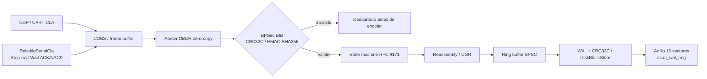
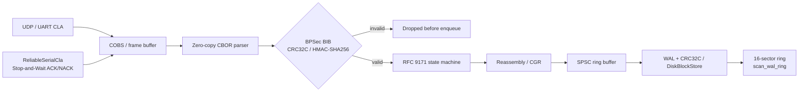

# dtn-core — Motor DTN (BPv7) `no_std` y cero asignaciones

[](#verificacion)
[](#verificacion)
[](https://docs.rust-embedded.org/book/intro/no-std.html)
[](#licencia)

Requiere Rust estable 1.80 o posterior (fijado en `rust-toolchain.toml`).
Miri se ejecuta con `nightly` porque no es componente del toolchain estable.

## Índice / Index

- [Español](#español)
- [English](#english)

---

## Español

`dtn-core` implementa los componentes centrales de un motor DTN (Bundle
Protocol v7, RFC 9171) para sistemas embebidos *bare-metal* y `no_std`.
Garantías de diseño:

- **Cero asignaciones en el hot-path.** El crate es estrictamente `#![no_std]`;
  no enlaza `alloc`. Cada buffer es un slice prestado o un arreglo de tamaño
  constante definido por el llamador.
- **Zero-copy con lifetimes explícitos.** Los parsers devuelven referencias al
  slice original; no se copian cabeceras ni payloads BP.
- **Errores explícitos.** Toda operación falible devuelve
  `DtnResult<T> = Result<T, DtnError>`, un discriminante `Copy` sin `panic`
  ante entrada hostil.
- **Corrección con memoria débil.** El ring buffer SPSC usa acquire/release;
  las métricas usan relaxed / fetch-min / fetch-max según corresponda.
- **Persistencia atómica.** Cada registro del WAL se sella en una página con
  CRC32C y número de secuencia monótono; `recover()` descarta escrituras
  parciales y corrupción de bits. `scan_wal_ring()` reconstruye un anillo de
  16 sectores reutilizando una sola página de 4 KiB.
- **Integridad BPSec.** El pipeline verifica el BIB (RFC 9172) antes de
  encolar: CRC32C o HMAC-SHA-256, sin `alloc`, con rechazo determinista ante
  alteración del payload o de la firma (CRC32C / HMAC).
- **Enlace confiable.** `ReliableSerialCla` añade Stop-and-Wait ARQ sobre COBS
  con tiempo inyectado (`u64`), ACK/NACK y retención del bundle en WAL tras
  agotar `max_retries`.

### Módulos

| Módulo | Contenido |
|--------|-----------|
| `error` | `DtnError` / `DtnResult`: errores `Copy`, sin `std::error::Error`. |
| `parser::cbor` | Primitivas CBOR acotadas: longitudes, saltos con límite de profundidad. |
| `parser::primary_block` | Bloque primario RFC 9171 (arreglo de 8–11 elementos) y formato mapa heredado; `ParsedBundleHeader::rfc_array` distingue ambos. |
| `parser::extension_blocks` | Bloques canónicos (Payload=1, Previous Node=6, Bundle Age=7, Hop Count=10) y validación de edad/saltos. |
| `processor::state_machine` | Política RFC 9171: expiración, longitud de lifetime, Bundle Age, Hop Count, flags de borrado, payload único y último. |
| `processor::fragmentation` | `ReassemblySlot<const BUF_SIZE, const MAX_FRAGMENTS>`: tabla de rangos que rechaza duplicados y solapamientos parciales; orden arbitrario. |
| `processor::pipeline` | `IngestionPipeline`: validación → reensamblado → CGR → cola SPSC → WAL. |
| `routing::interval_tree` | `CgrIntervalTree<const CAP>`: búsqueda EAT; solapamientos prefieren la ventana activa más larga. |
| `storage::ring_buffer` | `LockFreeRingBuffer<const SIZE>` SPSC alineado a 64 bytes. |
| `storage::crc32c` | CRC32C (Castagnoli) sin tabla, por chunks. |
| `storage::wal` | `DirectWal<const PAGES>`: 1 registro por página de 4096 B, `recover_pages()` y `scan_wal_ring()` (anillo de 16 sectores con un solo buffer de 4 KiB). |
| `storage::disk_sink` | `DiskBlockStore<const MAX_PAGES>` y `recover()` sobre el WAL en disco. |
| `bpsec` | BIB (RFC 9172) tipo 11: CRC32C siempre disponible y HMAC-SHA-256 con el feature `bpsec`; `attach()` / `verify()` sin `alloc`. |
| `cla::udp` | `UdpFrameBuffer<const MAX_FRAME_SIZE>` sin heap. |
| `cla::serial` | `SerialFraming<const RX, const TX>` con COBS (`0x00` delimitador) para UART/RS-485. |
| `cla::reliable` | `ReliableSerialCla` sobre COBS: cabecera `[tipo|seq u16]`, Stop-and-Wait ARQ con timeout inyectado, ACK/NACK y `max_retries`. |
| `telemetry::metrics` | Contadores y latencia atómicos (`snapshot()`, `reset()`). |

### Arquitectura



### Uso mínimo

```rust
use dtn_core::processor::state_machine::{BundleProcessor, ProcessStatus};

let bundle = [
    0x9f, 0x88, 0x07, 0x00, 0x00,
    0x82, 0x01, 0x00, 0x82, 0x01, 0x00, 0x82, 0x01, 0x00,
    0x82, 0x00, 0x01, 0x19, 0xea, 0x60,
    0x85, 0x01, 0x01, 0x00, 0x00, 0x41, 0x58, 0xff,
];
let result = BundleProcessor::process_bundle(&bundle, 1_000, None);
assert_eq!(result.status, ProcessStatus::Accepted);
```

### Verificación

```fish
cargo test --lib                  # 91 tests unitarios
cargo test --bins                 # binarios
cargo test                        # integración + doctests (13)
cargo +nightly miri test --lib    # provenance / data races (91 tests)
cargo bench --no-run              # compila todos los benchmarks
cargo doc --no-deps               # Documentación sin warnings
```

Para benchmarks de rendimiento:

```fish
cargo bench --bench pipeline_bench
```

### ESP32 y despliegue `no_std`

El ejemplo [`examples/esp32_node.rs`](examples/esp32_node.rs) muestra una
configuración de bajo SRAM (COBS 256+256 B, ring 16 B, ADU 128 B, WAL 1 página)
y se ejecuta en host con:

```fish
cargo run --example esp32_node
```

Para firmware real en ESP32:

1. Añadir `dtn-core` como dependencia de un crate `esp-hal` / `esp-idf-sys`.
2. Seleccionar el target: `xtensa-esp32-espidf` (ESP32 clásico) o
   `riscv32imc-esp-espidf` (ESP32-C3/C6). Instalarlo con
   `rustup target add <target>` y usar `espup` para el toolchain Xtensa.
3. Llamar a `IngestionPipeline::ingest_and_route` desde una tarea de alta
   prioridad; alimentar `SerialFraming::push_byte` desde la ISR del UART.
4. Ajustar las const-generic al SRAM disponible. El ejemplo usa menos de 5 KB
   estáticos; el WAL de 1 página (4096 B) domina el presupuesto.
5. En placas sin 4096 B contiguos, reducir el WAL a 0 páginas usando el
   fallback directo a `DiskBlockStore` o aumentar el heap del RTOS.

También se incluye el firmware RV32 de ejemplo:

```fish
cargo build --release --target riscv32imc-unknown-none-elf --example rv32_sim
```

### Inyección de caos

```fish
cargo run --bin dtnd
cargo run --bin chaos_injector -- --target 127.0.0.1:4556 --interval-ms 50 --count 500
cargo test --test chaos_matrix -- --nocapture
```

La matriz cubre bundles válidos, expirados, sin payload, truncados, bitflips,
ruido y estrés en lotes cortos. La terminología "NASA-style" describe la
práctica de fault injection; no implica certificación ni equivalencia con
pruebas de radiación.

### Limitaciones y roadmap

- BPSec BIB implementado (CRC32C y HMAC-SHA-256). El cifrado BCB y los
  contextos de seguridad adicionales quedan para una iteración futura.
- TCP, BLE y LoRa quedan para una iteración futura (UDP y UART/COBS disponibles).
- El ring buffer es SPSC; no ofrece persistencia multi-productor.
- `DirectWal::append` rechaza registros mayores que una página en lugar de
  dividirlos: evita anunciar como durables registros parcialmente escritos.

### Licencia

MIT o Apache-2.0, a elección del usuario. Ver [LICENSE-MIT](LICENSE-MIT) y
[LICENSE-APACHE](LICENSE-APACHE).

---

## English

`dtn-core` implements core components of a DTN engine (Bundle Protocol v7,
RFC 9171) for bare-metal and `no_std` embedded systems. Design guarantees:

- **Zero heap allocation in the hot path.** The crate is strictly `#![no_std]`
  and never links `alloc`. Every buffer is a borrowed slice or a caller-owned
  const-sized array.
- **Zero copy with explicit lifetimes.** Parsers return references into the
  original packet; BP headers and payloads are never duplicated.
- **Explicit errors.** Every fallible operation returns `DtnResult<T>` with a
  `Copy` `DtnError` discriminant, never a panic on hostile input.
- **Weak-memory correctness.** The SPSC ring buffer uses acquire/release;
  metrics use relaxed / fetch-min / fetch-max as appropriate.
- **Atomic persistence.** Each WAL record is sealed in a page with CRC32C and a
  monotonic sequence number; `recover()` discards torn writes and bit flips.
  `scan_wal_ring()` recovers a 16-sector ring using a single 4 KiB page.
- **BPSec integrity.** The pipeline verifies the RFC 9172 BIB before enqueueing
  (CRC32C or HMAC-SHA-256, allocation-free), deterministically rejecting any
  payload or tag modification.
- **Reliable link.** `ReliableSerialCla` adds Stop-and-Wait ARQ over COBS with
  injected `u64` ticks, ACK/NACK and WAL retention after `max_retries`.

### Modules

| Module | Contents |
|--------|----------|
| `error` | `DtnError` / `DtnResult`: `Copy` errors, no `std::error::Error`. |
| `parser::cbor` | Bounded CBOR primitives: lengths, depth-limited skipping. |
| `parser::primary_block` | RFC 9171 primary block (8–11 element array) plus legacy map format; `ParsedBundleHeader::rfc_array` distinguishes them. |
| `parser::extension_blocks` | Canonical blocks (Payload=1, Previous Node=6, Bundle Age=7, Hop Count=10) and age/hop validation. |
| `processor::state_machine` | RFC 9171 policy: expiry, lifetime, Bundle Age, Hop Count, deletion flags, single/last payload. |
| `processor::fragmentation` | `ReassemblySlot<const BUF_SIZE, const MAX_FRAGMENTS>` with a range table that rejects duplicates and partial overlaps; arbitrary order. |
| `processor::pipeline` | `IngestionPipeline`: validate → reassemble → CGR → SPSC queue → WAL. |
| `routing::interval_tree` | `CgrIntervalTree<const CAP>`: EAT lookup; overlaps prefer the longest remaining window. |
| `storage::ring_buffer` | `LockFreeRingBuffer<const SIZE>` SPSC, 64-byte aligned. |
| `storage::crc32c` | Table-free CRC32C (Castagnoli), chunked. |
| `storage::wal` | `DirectWal<const PAGES>`: one record per 4096-byte page, `recover_pages()` and `scan_wal_ring()` (16-sector ring with a single 4 KiB buffer). |
| `storage::disk_sink` | `DiskBlockStore<const MAX_PAGES>` and WAL `recover()` on disk. |
| `bpsec` | RFC 9172 BIB type 11: always-available CRC32C and HMAC-SHA-256 behind the `bpsec` feature; allocation-free `attach()` / `verify()`. |
| `cla::udp` | `UdpFrameBuffer<const MAX_FRAME_SIZE>` without heap. |
| `cla::serial` | `SerialFraming<const RX, const TX>` with COBS (`0x00` delimiter) for UART/RS-485. |
| `cla::reliable` | `ReliableSerialCla` over COBS: `[type|seq u16]` header, Stop-and-Wait ARQ with injected timeout, ACK/NACK and `max_retries`. |
| `telemetry::metrics` | Atomic counters and latency (`snapshot()`, `reset()`). |

### Architecture



### Minimal usage

```rust
use dtn_core::processor::state_machine::{BundleProcessor, ProcessStatus};

let bundle = [
    0x9f, 0x88, 0x07, 0x00, 0x00,
    0x82, 0x01, 0x00, 0x82, 0x01, 0x00, 0x82, 0x01, 0x00,
    0x82, 0x00, 0x01, 0x19, 0xea, 0x60,
    0x85, 0x01, 0x01, 0x00, 0x00, 0x41, 0x58, 0xff,
];
let result = BundleProcessor::process_bundle(&bundle, 1_000, None);
assert_eq!(result.status, ProcessStatus::Accepted);
```

### Verification

```fish
cargo test --lib                  # 74 unit tests
cargo test --bins                 # binaries
cargo test                        # integration + 13 doctests
cargo +nightly miri test --lib    # provenance / data races (91 tests)
cargo bench --no-run              # compile all benchmarks
cargo doc --no-deps               # docs without warnings
```

For performance benchmarks:

```fish
cargo bench --bench pipeline_bench
```

### ESP32 and `no_std` deployment

[`examples/esp32_node.rs`](examples/esp32_node.rs) demonstrates a low-SRAM
configuration (COBS 256+256 B, 16-byte ring, 128-byte ADU, 1-page WAL) and runs
on the host with:

```fish
cargo run --example esp32_node
```

For real ESP32 firmware:

1. Add `dtn-core` as a dependency of an `esp-hal` / `esp-idf-sys` crate.
2. Select the target: `xtensa-esp32-espidf` (classic ESP32) or
   `riscv32imc-esp-espidf` (ESP32-C3/C6). Install it with
   `rustup target add <target>` and use `espup` for the Xtensa toolchain.
3. Call `IngestionPipeline::ingest_and_route` from a high-priority task and feed
   `SerialFraming::push_byte` from the UART ISR.
4. Tune the const generics to the available SRAM. The example stays under 5 KB
   static; the 4096-byte WAL page dominates the budget.
5. On boards without 4096 contiguous bytes, reduce the WAL to 0 pages and use
   the `DiskBlockStore` fallback or increase the RTOS heap.

An RV32 bare-metal example is also included:

```fish
cargo build --release --target riscv32imc-unknown-none-elf --example rv32_sim
```

### Chaos injection

```fish
cargo run --bin dtnd
cargo run --bin chaos_injector -- --target 127.0.0.1:4556 --interval-ms 50 --count 500
cargo test --test chaos_matrix -- --nocapture
```

The matrix covers valid, expired, missing-payload, truncated, bit-flipped,
noisy and short stress batches. "NASA-style" refers to fault-injection
practice; it is not a certification or radiation-test equivalence.

### Limitations and roadmap

- BPSec BIB is implemented (CRC32C and HMAC-SHA-256). BCB confidentiality and
  additional security contexts are future work.
- TCP, BLE and LoRa are future work (UDP and UART/COBS are available).
- The ring buffer is SPSC; no multi-producer persistence.
- `DirectWal::append` rejects records larger than one page instead of splitting
  them, so a partially written record is never reported as durable.

### License

MIT or Apache-2.0, at the user's choice. See [LICENSE-MIT](LICENSE-MIT) and
[LICENSE-APACHE](LICENSE-APACHE).
